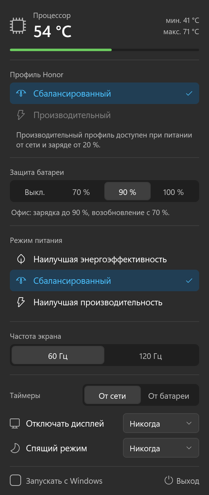
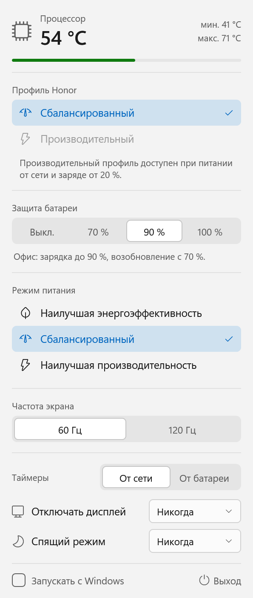

# TempTray

Небольшая программа для трея Windows: показывает температуру процессора прямо в значке и по клику открывает окно быстрых настроек питания. Рассчитана на ноутбуки Honor, но температура и остальные настройки работают на любом ПК с Windows.



## Возможности

- **Температура процессора** в значке трея, а в окне — минимум и максимум за сеанс.
- **Профиль Honor** (сбалансированный / производительный) — переключается так же, как в Honor PC Manager.
- **Защита батареи** (выкл. / 70 % / 90 % / 100 %). Прошивка сбрасывает пороги зарядки после сна и перезагрузки — TempTray следит за этим и возвращает выбранные пороги.
- **Защита зрения** (выкл. / холоднее / стандарт / теплее) и **цветовой режим** экрана («родной» без коррекции, sRGB, P3, HDTV, игровой и другие — те же, что в «Управлении цветом» PC Manager). Работает через Intel Graphics Control Library: защита зрения — таблица с ослабленным синим каналом, цветовой режим — 3D-таблица из заводской калибровки панели и ICC-профиль. Драйвер сбрасывает таблицы после сна, TempTray возвращает их.
- **Схема электропитания** Windows.
- **Частота экрана** (60 / 120 Гц).
- **Таймеры** отключения дисплея и перехода в спящий режим отдельно для работы от сети и от батареи.
- **Автозапуск** вместе с Windows через планировщик заданий (без запроса UAC при каждом входе).
- Светлая и тёмная темы.



## Требования

- Windows 10/11 x64
- [.NET 8 Desktop Runtime](https://dotnet.microsoft.com/download/dotnet/8.0)
- Права администратора (нужны для чтения температуры процессора)
- Функции Honor (профиль, защита батареи) доступны только на ноутбуках Honor с установленным PC Manager
- Защита зрения и цветовые режимы: ноутбук Honor с графикой Intel (драйвер с `ControlLib.dll`) и калибровочными файлами панели в `C:\Windows\System32\spool\drivers\color`

## Сборка

```bash
dotnet build -c Release
```

Один исполняемый файл:

```bash
dotnet publish -c Release -o publish
```

В конфигурации Debug программа запускается без прав администратора.

## Используемые компоненты

- [LibreHardwareMonitor](https://github.com/LibreHardwareMonitor/LibreHardwareMonitor) — чтение датчиков

## Лицензия

[MIT](LICENSE)
